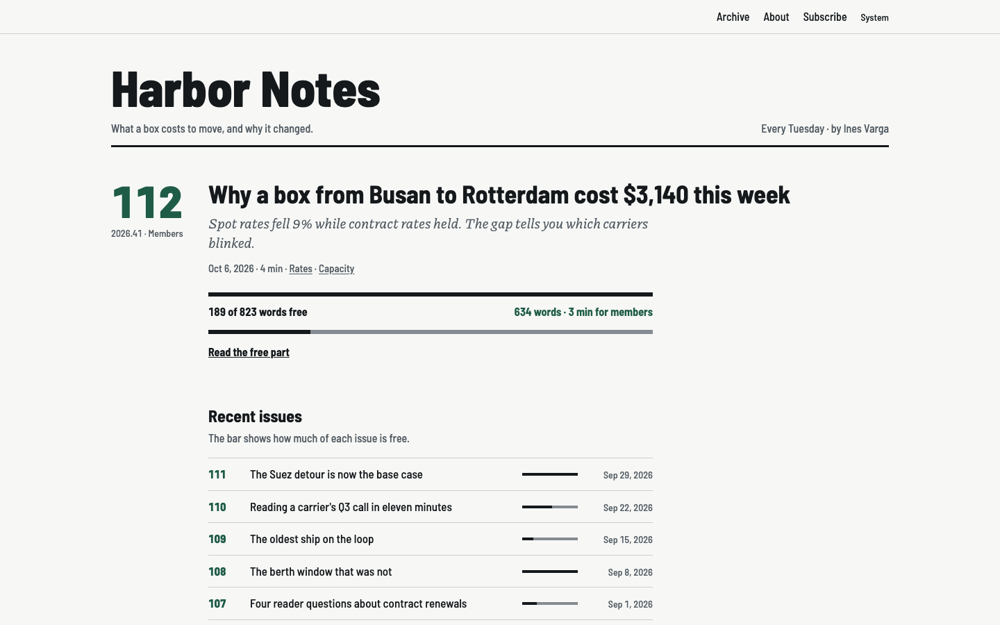

# Tearsheet

An Astro theme for a newsletter: ruled pages, issue numbers in the margin, and The Cut, which
removes the members part of an issue from the build. Free and MIT-licensed.

[Live demo](https://tearsheet-free.ondelva.com) · [Pro demo](https://tearsheet.ondelva.com) ·
[Get Pro](https://buy.polar.sh/polar_cl_EdLE1JPAd1gg6NuvLXcytVhMelq4fakFk3Kfy1MyAEB)



## What it is

Tearsheet is for analysts, consultants and reporters who write a newsletter and want its archive on
a site they own. It takes its manners from the trade journal and the analyst briefing: heavy rules
instead of cards, the issue number hung large in the margin, an archive set like a ledger, one
green for the numbers and nothing else coloured. A text serif and an italic dek keep it from going
cold.

**The Cut** is what it is built around. A members issue ends its free part with a heavy rule, a
count of what is left (`You've read 410 of 1,320 words · 910 words, 5 min for members`), a meter,
and the subscribe form. The rest of the issue is removed while the site is built, so it is not in
the HTML or the feed. A static site cannot run a paywall; this one makes sure it never publishes
what the paywall is for. `pnpm check:cut` proves it after every build.

## Features

- Astro 7 + Tailwind CSS v4, static output, no client-side JavaScript except the theme toggle
- The Cut on every members issue, a free/members meter on every archive row, and a switch for a
  plain "Continue reading" link instead
- Issue numbers and ISO week labels computed from the date
- Home, issue, archive by year, topic pages, subscribe with a plans table, a thank-you page,
  about, privacy, terms and 404
- Subscribe forms for Buttondown, plain HTML, and `DEMO_FORMS=1` for preview builds
- Pictures in issues resized to a `srcset` at build time, with plain-Markdown captions; a
  picture after the cut is cut with the text
- Dark mode, responsive from 360px
- Meta, Open Graph, JSON-LD, feed, sitemap, `robots.txt`, and an analytics slot (Plausible, GA4,
  Umami)
- Lighthouse 95+ on all four categories, checked in CI, together with the leak check
- Type-safe content collection (Markdown and MDX), and `AGENTS.md` for Claude Code / Cursor

## Quick start

You need Node.js 22.12+ and pnpm 9 or newer (`npm i -g pnpm`). `package.json` pins the exact pnpm
version, and pnpm 10+ switches to it on its own.

```sh
pnpm create astro@latest my-newsletter -- --template ondelva/astro-theme-tearsheet
cd my-newsletter
pnpm install
pnpm dev
```

`pnpm dev` also serves `/styleguide`, every colour token and type size on one page. It is not
part of a build.

## Configure

Everything site-specific lives in `src/config.ts`: the name, the URL, the cadence, the plans, your
Buttondown username, the switches. Colours are tokens you override in `src/styles/theme.css`.

- [docs/customization.md](docs/customization.md): every config group, the tokens, the switches
- [docs/content.md](docs/content.md): writing an issue and the cut marker
- [docs/deploy.md](docs/deploy.md): build, hosting, CI

## Deploy

Static output. Works on Cloudflare, Vercel, Netlify and GitHub Pages. One click and the host clones
this repository into your account, builds it and puts it online:

[](https://deploy.workers.cloudflare.com/?url=https://github.com/ondelva/astro-theme-tearsheet)
[](https://app.netlify.com/start/deploy?repository=https://github.com/ondelva/astro-theme-tearsheet)
[](https://vercel.com/new/clone?repository-url=https://github.com/ondelva/astro-theme-tearsheet)

Set `SITE_URL` to your address afterwards. Before your first members issue, make sure the new
repository is **private**: the members text is cut from the site, not from the repository. See
[docs/deploy.md](docs/deploy.md).

## Free vs Pro

This edition is a finished newsletter site with The Cut. Pro is for moving an existing newsletter
over and running it: see it at [tearsheet.ondelva.com](https://tearsheet.ondelva.com), and
[buy it here](https://buy.polar.sh/polar_cl_EdLE1JPAd1gg6NuvLXcytVhMelq4fakFk3Kfy1MyAEB): $49 for one person, $129 for a team of up to ten.

|                | Free (this repo)                                           | Pro                                                  |
| -------------- | ---------------------------------------------------------- | ---------------------------------------------------- |
| Pages          | Home, issue, archive, topics, subscribe, about, legal, 404 | + search                                             |
| The Cut        | ✓                                                          | ✓                                                    |
| Archive        | By year, with meters                                       | + All/Free/Members filter                            |
| Search         | –                                                          | Pagefind, free parts only                            |
| Subscribe      | Buttondown                                                 | + any provider with an HTML embed                    |
| Migration      | –                                                          | Substack import                                      |
| Components     | Markdown                                                   | + key numbers, rate tables, callouts, related issues |
| Share cards    | One default image                                          | One per issue, with number and meter                 |
| Colour presets | 1                                                          | 4                                                    |
| Font pairings  | 1                                                          | 2                                                    |
| License        | MIT                                                        | Commercial, unlimited end products                   |
| Footer credit  | One line, easy to remove                                   | None                                                 |
| Support        | GitHub Issues                                              | Email (im@ondelva.com), 2 business days              |

## Screenshots

More in [docs/screenshots/](docs/screenshots/): the home page, a members issue and the archive,
light and dark, desktop and mobile.

## License

MIT, see [LICENSE](LICENSE).
Third-party assets: [THIRD-PARTY-NOTICES.md](THIRD-PARTY-NOTICES.md)
