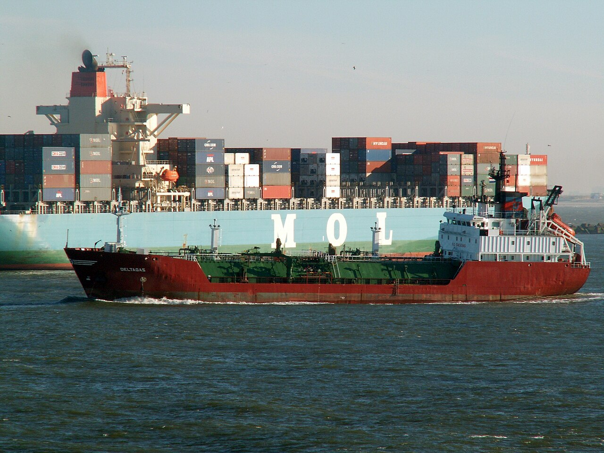
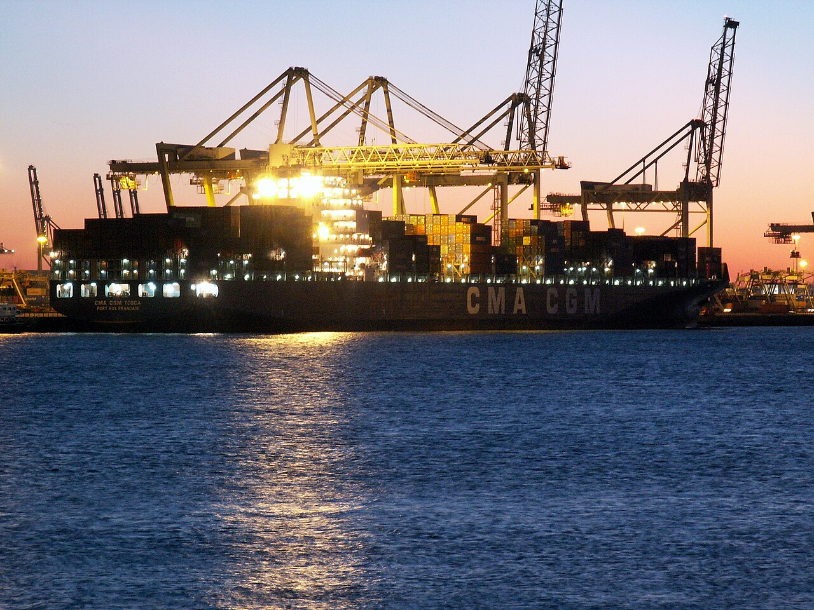

Last month I found a 24-year-old container ship on an Asia to North Europe rotation, sailing in the third slot of a weekly service from Ningbo to Hamburg. It was built in 2002, rated at 8,400 TEU, and has had four names.[^1] Its presence tells you something about how carriers manage the end of a cycle, and it is one of the better reasons to look at vessel age in the schedule data.

_A gas tanker turns ahead of a container ship at Rotterdam, January 2006. Photo: Alf van Beem, CC0._

Average age figures are published by classification societies and often quoted in carrier presentations. The number on main lanes has been falling for six years, now sitting at 11.2 years. A fleet with a falling average sounds like a fleet that is renewing itself. It is, but averages hide a distribution, and the distribution tells a different story.

<!-- cut -->

## The tail

In my sample of 38 services, 31 of the 412 vessel slots over six weeks were filled by ships older than 18 years. That is 7.5%. The ships are scattered, not concentrated: no carrier has more than five, and no service has more than two. The pattern suggests deliberate use, not neglect.

_CMA CGM Tosca under the cranes at a Rotterdam terminal, January 2006. Photo: Alf van Beem, CC0._

Three reasons stand out from the planners I spoke to.

First, old ships are cheap to hold. A vessel of that age has been depreciated to near zero in the books. A carrier that has already paid for it faces a charter-equivalent cost of about $9,000 a day, against $38,000 for a modern ship of the same size on a market charter.[^2] On a 14-day rotation leg, that difference is $406,000.

Second, they are useful in specific places. Smaller ships can call at ports where the draught or the crane reach suits them, and they fill the gaps in a rotation when a larger ship goes for dry-dock. An 8,400 TEU vessel does not need a deep berth.

Third, and least discussed, they provide optionality. A carrier that keeps four such ships on the books can put them into service within three weeks if demand rises, without chartering at spot prices. In weeks like this one, when spot rates are falling, they sit idle or at anchor. In weeks when rates spike, they sail.

## What the shipper sees

Very little, which is the point. The service code is the same, the schedule is the same, and the vessel name appears on the booking confirmation only if you look. The differences you might notice:

- Transit is typically one or two days longer, since older ships run slower to save fuel.
- Reefer plug capacity is lower, often by 20 to 30%.
- Reliability on schedule is worse, by about six percentage points in my data, though that is a noisy figure.

None of these is disastrous. For a dry container of furniture, nobody would care. For a reefer of produce on a tight shelf life, you would care a great deal, and you would not know to ask.

One planner described it to me as the difference between owning an umbrella and renting one when it rains. The old ships are the umbrellas. They cost almost nothing to keep, and they are very annoying to be without in the one week you need one. The same planner added that the umbrella is also unfashionable, and that no carrier will put its oldest ship in a brochure.

## A simple habit

When the booking confirmation arrives, copy the vessel name into a column. Look up its build year once; it takes ten seconds. If you see an age above 18, make a note, and if you see it twice on the same service in a quarter, ask your carrier what is going on. They will say "operational flexibility", and the question will have done its work.

I keep a list of the oldest ships on each of my tracked services. Currently the record is 24 years, as above. A reader has bet me a lunch that I will find a 27-year-old by Christmas. I have accepted.

[^1]: The previous names are in public registers. I have left them out because a name change is the carrier's business, not mine. The ship has also been through two ownership transfers. None of it is unusual.

[^2]: Charter-equivalent rates are rough figures from the charter market and from conversations with two brokers. Treat the $9,000 figure as an order of magnitude. Book values vary, and some carriers allocate overhead to old ships differently.
