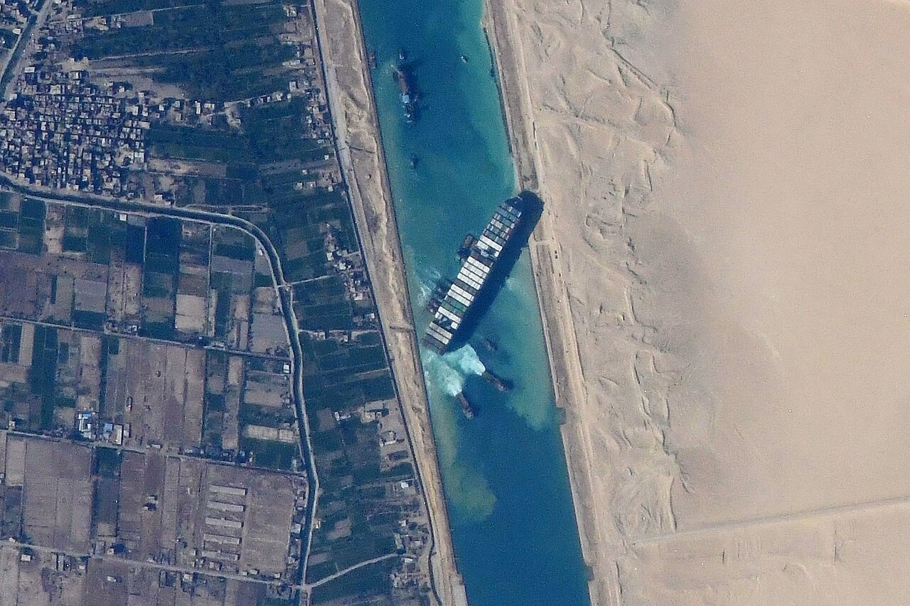

The word "temporary" has a half-life in freight. A diversion announced as a two-week measure becomes a quarter, then a season, then a feature of the schedule that nobody mentions because everyone has stopped being surprised. We are at the fourth stage with Suez. The Cape routing is not a detour any more. It is the plan.

_The Suez Canal from the International Space Station on 27 March 2021, with the Ever Given lodged across it. Photo: NASA, public domain._

I do not want to make a political argument here. The issue is operational, and the evidence is in the schedule files.

## What changed in the data

Six months ago, about 40% of the Asia to North Europe loops I track listed a planned Suez transit in their rotation, with the Cape shown as a contingency. This week, 6 of 38 do. Everything else has the Cape as the base, with a published transit time that now includes the extra ten to fourteen days and, importantly, a published bunker stop at a port on the African coast.

That last detail matters. A carrier that plans a bunker call at Las Palmas or Durban is not improvising. It has negotiated berth slots and supply contracts. You do not do that for a diversion you expect to end next month.

## The arithmetic of staying

A round trip on the Cape adds roughly 3,500 nautical miles each way compared with Suez. At 16 knots, that is about 9 days each leg. A service that used to need 9 ships for a weekly cycle now needs 11. The two extra ships come from somewhere: either newbuilds, which are arriving, or tonnage drawn from other trades, which is why Southeast Asia to Africa rates have drifted up by $140 this quarter.

Fuel is the other cost. A 14,000 TEU ship uses roughly 130 tonnes a day at those speeds. Nine extra days of that is 1,170 tonnes, and at $620 a tonne it is $725,000 a leg. Spread across 12,000 boxes, that is about $60 per container, which is exactly why the bunker surcharge on this trade rose by $55 in the same period.

## The shipper's problem

If you are buying on this trade, you already know all of this. The new problem is planning. A transit that was 30 days in 2023 is 42 now, and a safety stock calculation that assumed 30 is wrong by 12 days of inventory. A buyer at a homeware importer told me she moved her reorder trigger from 12 weeks to 14 and found it removed roughly 70% of her expediting costs. It cost her more in warehouse space, about £9,000 a quarter. The expediting savings were £21,000.

The other effect is on schedule reliability. Longer loops have more places to go wrong. In my data, on-time arrival on Cape-routed services is 58%, against 71% for the six services still transiting Suez. A 13 point gap in reliability is worth pricing into any contract, and I do not see it in the contracts I read.

## Where I could be wrong

A return to Suez is possible, and would arrive quickly. When carriers decide it is safe, they will announce it a few weeks ahead, and the surge in available capacity as the extra ships are released would push spot rates down by perhaps $400 to $600 on the trade. I think the odds of this before March are low, perhaps one in five, and that planning for it is a mistake for most shippers. Planning for the detour to continue costs you some warehouse space. Planning for the return, if it does not come, costs you a missed delivery.

There is a view among some analysts that the detour is good for carriers, since it absorbs capacity and supports rates. In my reading, it is good for carriers with spare ships and bad for those without, and the strain falls hardest on the mid-sized lines who lack the ships to maintain frequency. Three of them have already reduced a weekly service to every ten days.

For the moment, I treat the Cape as the base case in every model I build, and I treat any Suez return as an upside surprise. The surprise may come, and it is worth being pleased about it when it does. It is not worth waiting for.
